# Mi Cartelera Personal

App móvil (React Native + Expo, TypeScript) para buscar películas y series en **TMDB**, agregarlas a una lista personal y organizarlas por estado (_por ver_, _viendo_, _vista_), con calificación y comentario propios. Usa **Firebase Auth** para las cuentas y **Firestore** para guardar la lista, aislada por usuario.

## Entregable 3: épica «Mi año en cine»

Sobre el Proyecto 3 (etiqueta `p3-final`) se agregó, en la rama `main`, una pestaña **Mi año** que
resume lo visto en un año: obras (películas y series), horas de cine, género y director más vistos, mes más
activo con una barra por mes, obra destacada y selector de año.

**Qué cambió**

- **Datos:** cada obra guarda `vistaEn` (cuándo pasó a vista) y, al agregarla, `generos`, `duracionMin` y
  `directores` de TMDB. Las obras anteriores se migran solas al abrir Mi año (fechas y datos de TMDB, con
  progreso visible). Sin conexión el resumen usa la copia local.
- **Reglas de negocio** D1 a D13 en funciones puras de `src/dominio/`, con tests.
- **Reglas de Firestore** que validan los campos nuevos sin romper los documentos viejos.
- **Sistema de diseño:** brief, brand board, `DESIGN.md` y tokens en `src/tema/`; todas las pantallas usan tokens.
- **Harness del agente:** `AGENTS.md`, `CLAUDE.md`, skill `/commit`, hook de Prettier y sensores (tests).

**Documentos del proceso**

| Documento                                                                                                                    | Contenido                                           |
| ---------------------------------------------------------------------------------------------------------------------------- | --------------------------------------------------- |
| [`docs/AUDITORIA.md`](docs/AUDITORIA.md)                                                                                     | Auditoría inicial y final                           |
| [`docs/prd/PRD.md`](docs/prd/PRD.md)                                                                                         | PRD con D1 a D13 y puntos abiertos                  |
| [`docs/backlog/epica-mi-anio.md`](docs/backlog/epica-mi-anio.md)                                                             | Historias, criterios DADO/CUANDO/ENTONCES y tickets |
| [`docs/specs/01-mi-anio-en-cine.md`](docs/specs/01-mi-anio-en-cine.md)                                                       | Spec de la épica                                    |
| [`docs/diseno/BRIEF.md`](docs/diseno/BRIEF.md), [`brand-board.html`](docs/diseno/brand-board.html), [`DESIGN.md`](DESIGN.md) | Sistema de diseño                                   |
| [`docs/VERIFICACION.md`](docs/VERIFICACION.md)                                                                               | Verificación humana en el teléfono                  |
| [`docs/IA.md`](docs/IA.md)                                                                                                   | Momentos clave del trabajo con IA                   |
| [`docs/DEMO.md`](docs/DEMO.md)                                                                                               | Guion de la demo                                    |

### Cómo correr los tests

```bash
npm install
npm test                # Vitest: dominio (D1–D13), regla RF6, colores fijos y formatos
npx tsc --noEmit        # tipos
npm run test:reglas     # firestore.rules contra el emulador (requiere Java 21 y firebase-tools)
```

`npm test` no necesita `.env`, Firebase ni internet. Para `test:reglas`: instalar Java 21
(`winget install Microsoft.OpenJDK.21`) y `npm install -g firebase-tools`; usa un proyecto `demo-` local,
sin iniciar sesión.

## Objetivo

Integrar en una sola app funcional: autenticación con Firebase Auth, datos propios en Firestore, una API externa pública (TMDB), navegación con React Navigation, estado global con Context API y caché local con AsyncStorage, todo escrito en TypeScript.

## Pantallas

| Pantalla              | Contenido                                                                                                                              | Navegación       |
| --------------------- | -------------------------------------------------------------------------------------------------------------------------------------- | ---------------- |
| **Login / Registro**  | Formulario con validación y alternancia entre modos; errores de Firebase traducidos                                                    | Solo sin sesión  |
| **Buscar**            | Búsqueda combinada de películas y series con carátula, título y año; paginación infinita                                               | Pestaña          |
| **Detalle de TMDB**   | Póster, sinopsis (con respaldo en inglés y texto alternativo), calificación de TMDB, géneros y elenco; botón _Agregar a mi lista_      | Pila             |
| **Mi lista**          | Filtros por estado y por tipo, contadores, tarjetas con calificación personal; aviso cuando se muestra la copia sin conexión           | Pestaña          |
| **Editar mi entrada** | Selector de estado, calificación de 1 a 5 (solo si está _vista_), comentario de hasta 500 caracteres y botón _Quitar_ con confirmación | Modal de la pila |
| **Acerca de**         | Datos de la app, cuenta, logo y aviso de TMDB, cierre de sesión                                                                        | Pestaña          |

## Requisitos funcionales

| #    | Cómo se cumple                                                                                                                                                                         |
| ---- | -------------------------------------------------------------------------------------------------------------------------------------------------------------------------------------- |
| RF1  | `authService` + `initializeAuth` con `getReactNativePersistence(AsyncStorage)`; `RootNavigator` muestra Login o la app según la sesión; `utils/erroresFirebase.ts` traduce los códigos |
| RF2  | `tmdbService.buscar` (`/search/multi`); estados _cargando / error / sin resultados_; póster de relleno                                                                                 |
| RF3  | `tmdbService.obtenerDetalle` con `append_to_response=credits` (detalle y elenco en una petición)                                                                                       |
| RF4  | `listaService.agregarElemento`: id `tipo_tmdbId`, comprobación previa y regla de Firestore                                                                                             |
| RF5  | Filtros por estado y tipo en `MiListaScreen`                                                                                                                                           |
| RF6  | `EditarScreen` + `normalizarCambios`; la calificación se anula si el estado no es _vista_ (también en las reglas)                                                                      |
| RF7  | `Alert` de confirmación antes de borrar                                                                                                                                                |
| RF8  | Cada mutación actualiza estado local + Firestore + AsyncStorage; sin conexión se muestra la última copia con aviso; escrituras con tiempo máximo (`conTiempoLimite`)                   |
| RF9  | `AcercaDeScreen` con logo y aviso de TMDB y cierre de sesión                                                                                                                           |
| RF10 | TypeScript estricto sin `any`; capas `screens → context → services`                                                                                                                    |

## Arquitectura

```text
App.tsx                      Proveedores + navegación
src/
├── components/              Botón, Chip, Estrellas, Póster, estados, logo TMDB y los de Mi año
│                            (TarjetaDato, BarrasPorMes, TarjetaDestacada, SelectorAnio, AvisoSuave)
├── context/                 CarteleraContext: usuario, lista, acciones, caché y sincronización de un año
├── dominio/                 Reglas puras de la épica y sus tests: resumenAnual, vistaEn, datosTmdb, sincronizacion
├── navigation/              RootNavigator: pila + pestañas, login condicional
├── screens/                 Login, Buscar, Detalle, MiLista, MiAnio, Editar, AcercaDe
├── services/                ÚNICO lugar que llama a Firebase, TMDB, AsyncStorage y NetInfo
│   ├── firebaseConfig.ts
│   ├── authService.ts
│   ├── tmdbService.ts
│   ├── listaService.ts
│   ├── cacheService.ts
│   └── conexionService.ts
├── tema/                    Tokens de diseño (única fuente de colores y tamaños) y sensor de colores fijos
├── types/                   lista.ts (TipoObra, EstadoVisto, ElementoLista), tmdb.ts, peticion.ts, navegacion.ts
└── utils/                   validaciones, formatos, traducción de errores, tiempo límite
pruebas/reglas.test.ts       Sensor de firestore.rules (emulador)
firestore.rules              Reglas publicadas en Firebase
```

### Tipos principales

- `TipoObra = 'movie' | 'tv'` y `EstadoVisto = 'por_ver' | 'viendo' | 'vista'` (tipos unión).
- `EstadoPeticion<T>` (genérico) para cada petición: `cargando`, `exito` o `error`; se recorre con `switch` exhaustivo.
- `Record<EstadoVisto, string>` exhaustivos para etiquetas, colores e íconos: agregar un estado nuevo obliga a completarlos.
- `RespuestaPaginada<T>` para las respuestas de TMDB.

### Modelo de datos (Firestore)

Ruta: `usuarios/{uid}/mi_lista/{itemId}` con `itemId = tipo_tmdbId` (ej. `movie_550`, `tv_1399`).

Campos: `tmdbId`, `tipo`, `titulo`, `anio`, `posterPath`, `estado`, `calificacionPersonal`, `comentario`, `agregadoEn`, `actualizadoEn` (`serverTimestamp`).

Campos de la épica (opcionales, los documentos viejos no los tienen): `vistaEn` (marca de tiempo o `null`, solo si está vista), `generos` (máx. 10), `duracionMin` (entero 1–1000 o `null`) y `directores` (máx. 10).

### Seguridad

`firestore.rules` permite leer/escribir solo al dueño (`request.auth.uid == userId`) y además valida en el servidor: campos permitidos, tipos, `itemId == tipo_tmdbId`, estado válido, comentario ≤ 500, calificación entera 1–5 solo si el estado es _vista_, alta siempre en _por_ver_, marcas de tiempo del servidor y que la obra no cambie al actualizar. Todo lo demás está denegado.

## Instalación

Requisitos: Node 22.12+ o 24+ (lo exige Vitest), app **Expo Go** en el teléfono (o un emulador).

```bash
git clone https://github.com/Nahimshino/Entregable-3-Mi-a-o-en-Cartelera.git
cd Entregable-3-Mi-a-o-en-Cartelera
npm install
cp .env.example .env     # y completar los valores
npm run dev              # equivale a: npx expo start
```

Escanea el código QR con Expo Go. Comprobación de tipos: `npm run typecheck`.

### Variables de entorno (`.env`)

| Variable                                                       | De dónde sale                                                                |
| -------------------------------------------------------------- | ---------------------------------------------------------------------------- |
| `EXPO_PUBLIC_TMDB_TOKEN`                                       | TMDB → _Settings → API_ → **API Read Access Token** (se envía como `Bearer`) |
| `EXPO_PUBLIC_FIREBASE_API_KEY` … `EXPO_PUBLIC_FIREBASE_APP_ID` | Firebase → _Configuración del proyecto → Tus apps → App web_                 |

> **Riesgo de las claves `EXPO_PUBLIC_`:** se incrustan en el paquete de la app y cualquiera podría extraerlas. Para un proyecto no comercial es aceptable; la configuración de Firebase no es secreta (la protección real son las reglas de Firestore), pero el token de TMDB sí podría usarse en nombre de la cuenta. La solución de fondo sería un proxy (por ejemplo Express en Render) que guarde el token en el servidor. `.env` está en `.gitignore`; solo se sube `.env.example`.

### Publicar las reglas

```bash
npm install -g firebase-tools
firebase login
firebase deploy --only firestore:rules --project <id-del-proyecto>
```

## Atribución

This product uses the TMDB API but is not endorsed or certified by TMDB. Datos e imágenes de [The Movie Database (TMDB)](https://www.themoviedb.org/), uso no comercial.

## Evidencias

### Capturas de la app (móvil)

| Iniciar sesión                                     | Buscar                                                    | Resultados de búsqueda                                         | Mi lista vacía                                              |
| -------------------------------------------------- | --------------------------------------------------------- | -------------------------------------------------------------- | ----------------------------------------------------------- |
| 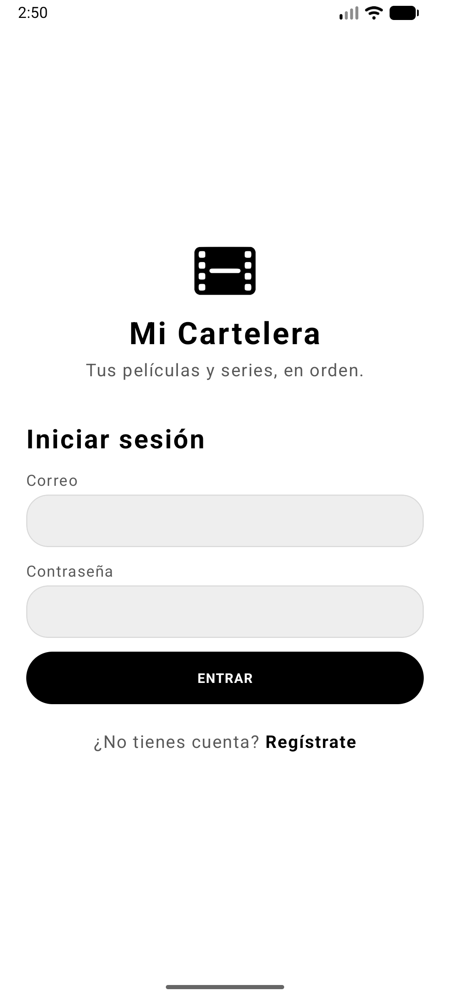 | 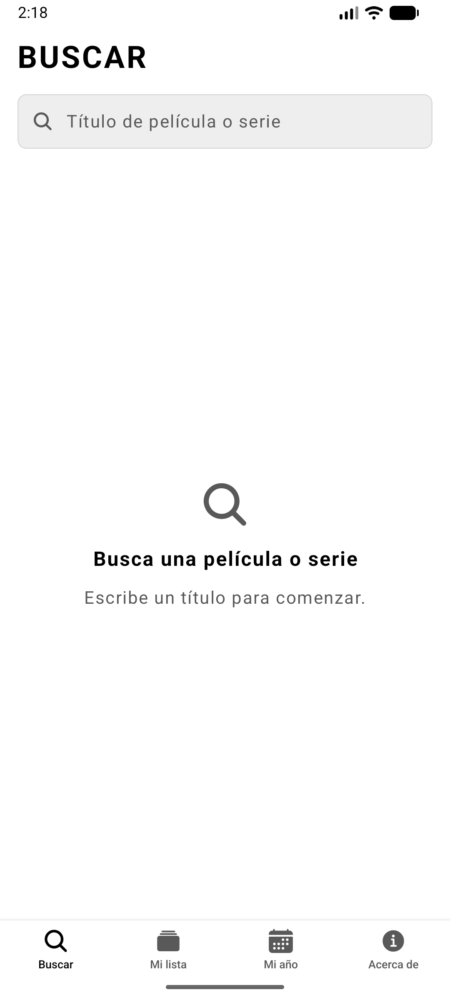 | 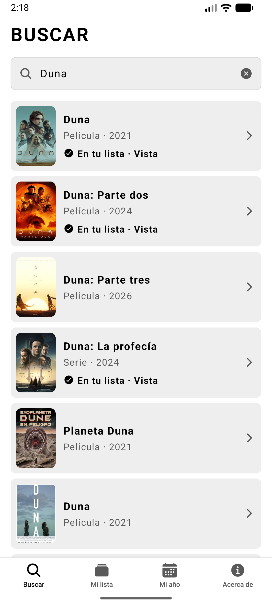 | 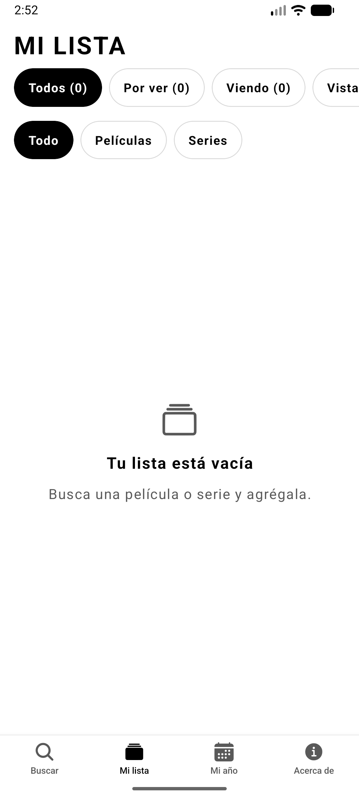 |

| Mi lista con películas                                          | Mi lista con una serie                                          | Filtro por series                                                   | Acerca de                                              |
| --------------------------------------------------------------- | --------------------------------------------------------------- | ------------------------------------------------------------------- | ------------------------------------------------------ |
| 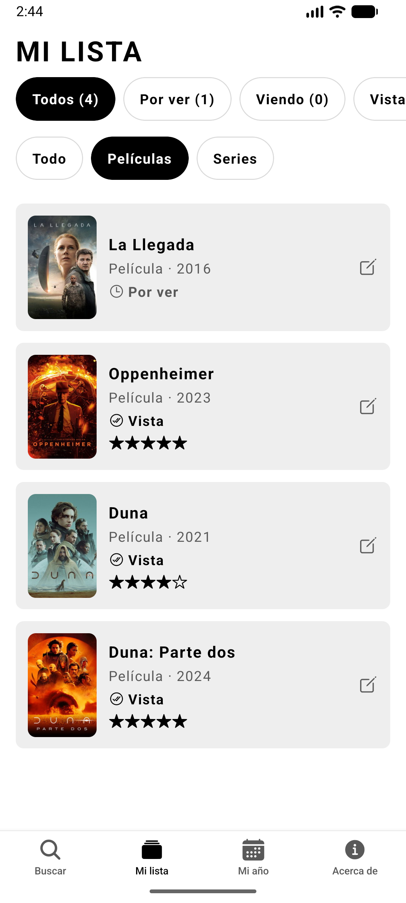 | 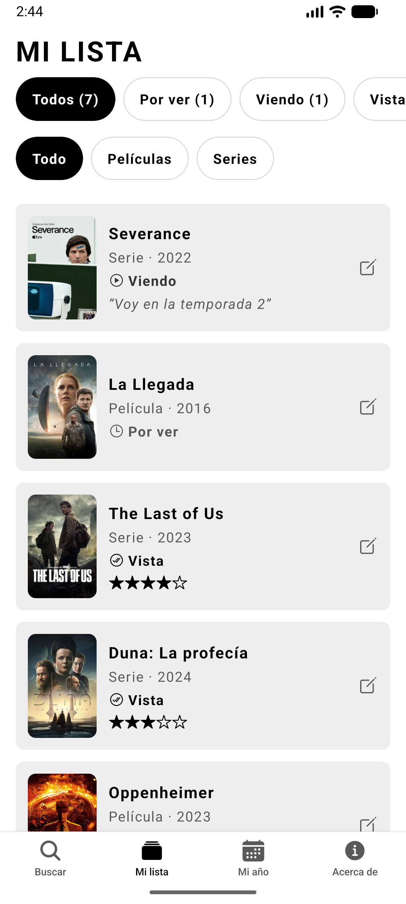 | 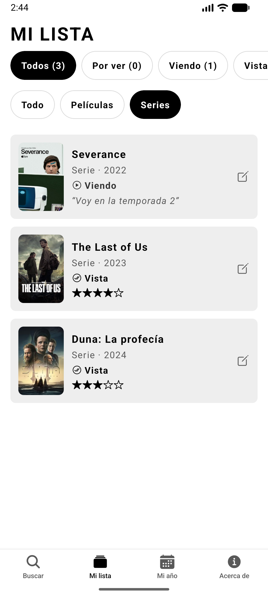 | 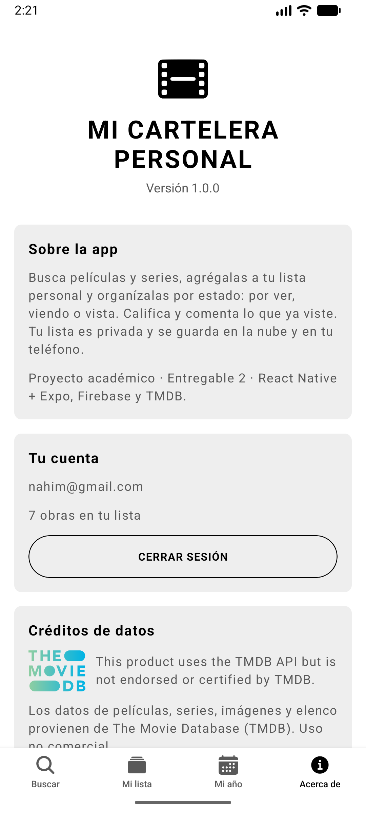 |

### Firebase

**Usuarios registrados** (_Authentication → Users_), incluidas las cuentas de prueba A y B:


**Subcolección `usuarios/{uid}/mi_lista`** con 4 documentos (id `tipo_tmdbId`):


**Simulador de reglas**: la cuenta B no puede leer la lista de otra cuenta; la dueña sí.

| Otra cuenta → rechazado                                                   | Dueña → autorizado                                                    |
| ------------------------------------------------------------------------- | --------------------------------------------------------------------- |
|  |  |

### Épica «Mi año en cine» (emulador Android)

| Resumen con datos (D7–D11)                                     | Año sin obras vistas (D12)                                 | Detalle: «En tu lista»                                           | Editar mi entrada                                           |
| -------------------------------------------------------------- | ---------------------------------------------------------- | ---------------------------------------------------------------- | ----------------------------------------------------------- |
| 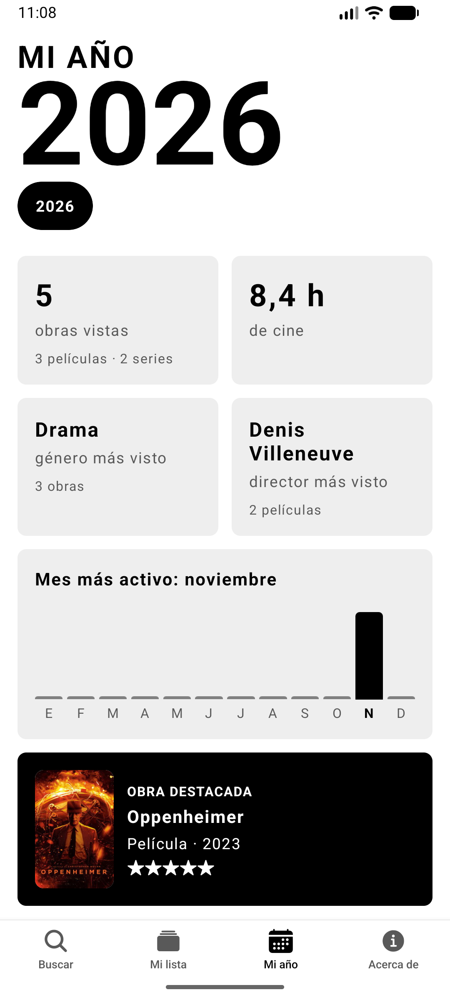 | 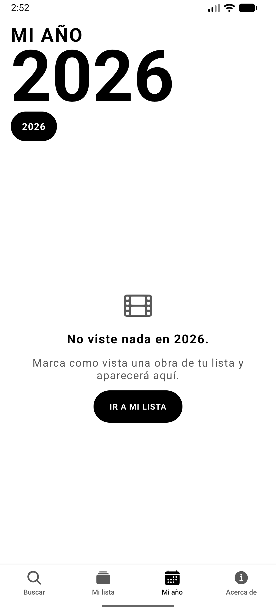 |  | 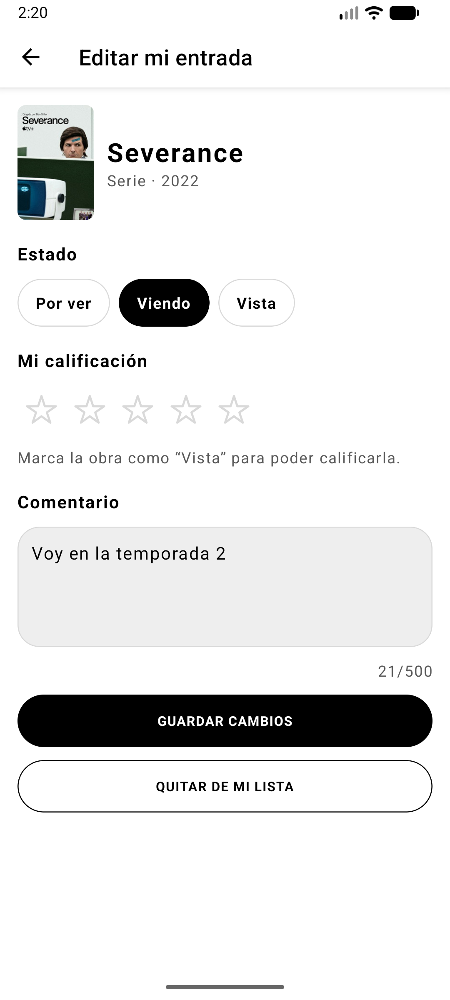 |

| Sin conexión: resumen con la copia guardada (D13)                 | Completando datos de TMDB (D6)                                      |
| ----------------------------------------------------------------- | ------------------------------------------------------------------- |
| 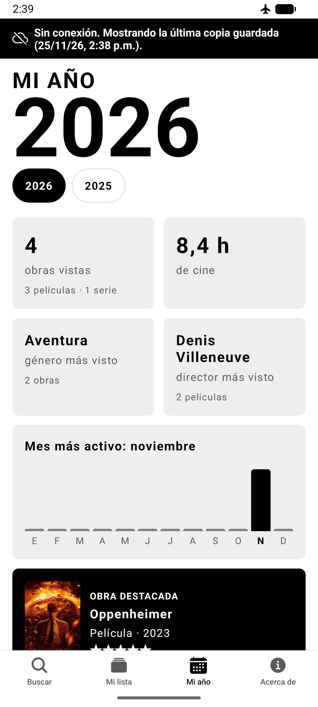 | 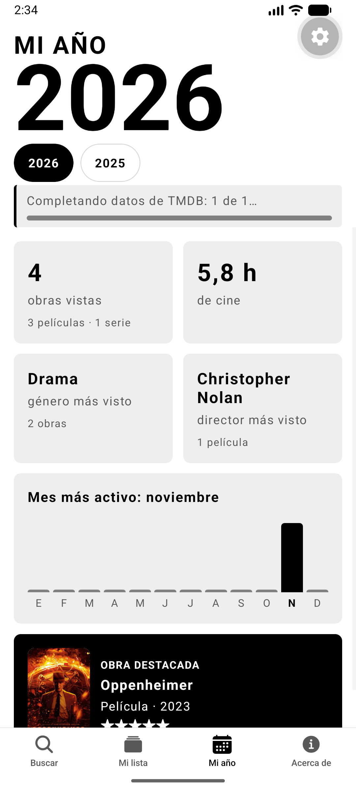 |

**Documento de `mi_lista` con los campos nuevos** (`vistaEn`, `generos`, `duracionMin`, `directores`), aceptado por
las reglas publicadas:

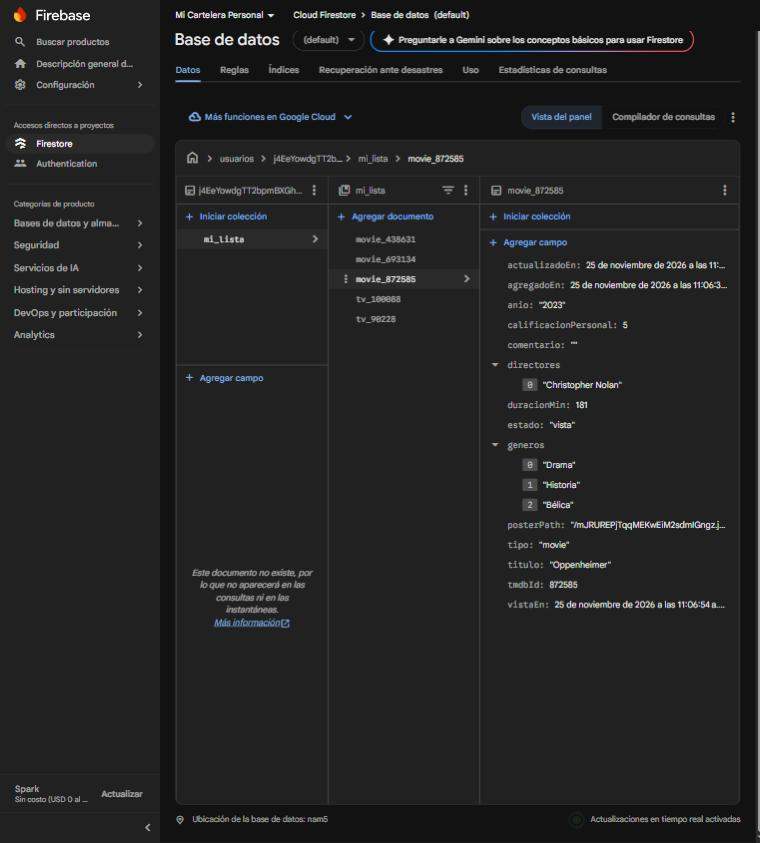

**`npm test` en verde** (8 archivos, 68 tests):

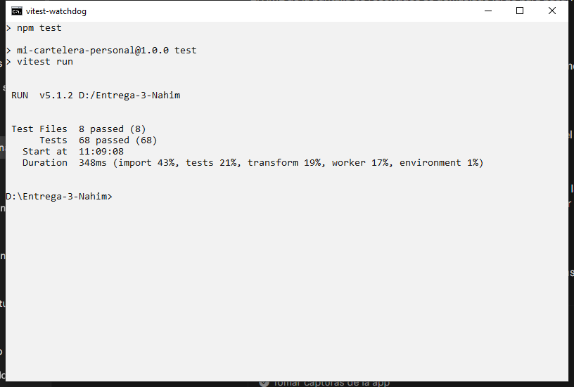

## Uso de IA

Ver [`docs/bitacora-ia.md`](docs/bitacora-ia.md).
